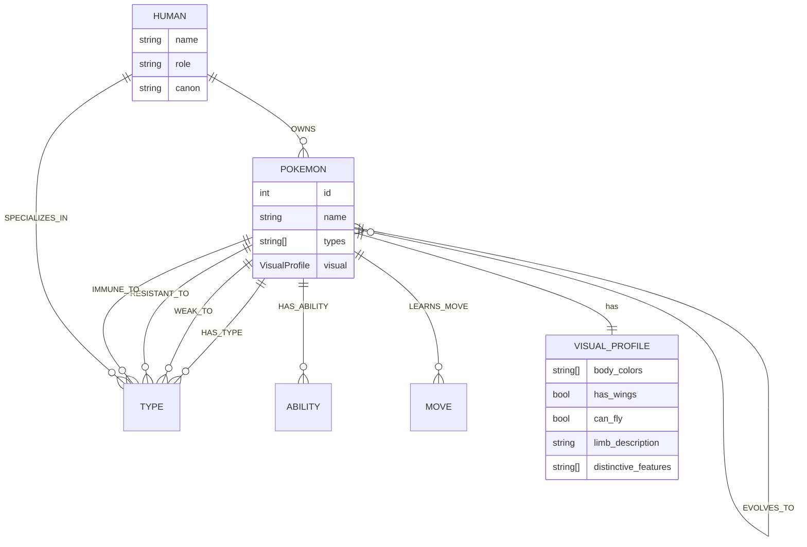

# poke-consistency-kit

A Gen-1 Pokémon ontology + knowledge graph + **visual-consistency toolkit for AI creators**.

AI image/video generators routinely mangle Pokémon anatomy — Pikachu with wings, Charizard with the wrong tail, Gyarados drawn with legs. This toolkit doesn't pretend a knowledge graph can reach into a diffusion model and fix pixels. Instead it provides the three things that *do* help: a curated visual ontology, positive-only prompt construction, and a VLM-based verification loop.

## The honest architecture

Text-only knowledge cannot fix diffusion-model visual errors, for three reasons:

1. **Diffusion models don't query databases.** They denoise pixels conditioned on a text embedding. A fact like "Pikachu has no wings" has to survive the text→pixel channel, which is lossy.
2. **Negation backfires.** Text encoders (CLIP/T5) handle "no wings" badly — mentioning wings can *increase* the chance of wings. Prompts must enumerate what *is* there, never what isn't.
3. **Some representations are suppressed on purpose.** Major models are fuzzy on Pokémon because it's IP-filtered territory. No ontology repairs a representation the model was trained to forget.

So where does a knowledge graph actually help? As the **spec sheet**, not the cure:

```
                    ┌─────────────────────┐
                    │  poke-consistency   │
                    │  knowledge graph    │
                    │  (150 Pokemon,      │
                    │   visual profiles,  │
                    │   20 humans, types)  │
                    └────────┬────────┬───┘
                             │        │
              ┌──────────────┘        └──────────────┐
              ▼                                      ▼
   ┌─────────────────────┐              ┌─────────────────────┐
   │ prompt_builder      │              │ verifier            │
   │ positive-only       │   generate   │ VLM checks the      │
   │ visual attributes   │ ──────────►  │ rendered image      │
   │ for the image model │   image      │ against the visual  │
   └─────────────────────┘              │ profile; FAIL →     │
                                        │ regenerate / fix    │
                                        └─────────────────────┘
```

Ranked by actual leverage on the "Pikachu with wings" problem: **reference images** (the graph indexes canonical sprites per Pokémon) > **VLM verification loop** > **positive-attribute prompts** > per-character LoRA (the graph organizes the dataset) > raw KG facts.

## What's in the box

- **Ontology** (`poke_kg/ontology.py`) — `Pokemon`, `VisualProfile`, `Human`, `Type`, `Move` dataclasses. Scope: Pokémon **#1–150 only** (Bulbasaur…Mewtwo; Mew excluded), the **15 Gen-1 types** (no Dark/Steel/Fairy), ~20 hand-curated Kanto humans.
- **Visual profiles** — per-Pokémon `body_colors`, `has_wings`, `can_fly`, `limb_description`, `distinctive_features`, canonical sprite URLs. Hand-curated where the API can't help (Doduo is Flying-type but famously flightless; Gyarados can't fly either — the graph knows).
- **Knowledge graph** (`poke_kg/graph.py`) — networkx MultiDiGraph with `HAS_TYPE`, `EVOLVES_TO`, `HAS_ABILITY`, `LEARNS_MOVE`, `WEAK_TO`/`RESISTANT_TO`/`IMMUNE_TO`, `OWNED_BY`, `SPECIALIZES_IN` edges, plus query helpers.
- **Prompt builder** (`poke_kg/prompt_builder.py`) — emits positive-only visual descriptions. A unit test asserts the negation invariant across all 150 Pokémon.
- **Verifier** (`poke_kg/verifier.py`) — `FakeVLM` for tests/demos, `OpenAICompatibleVLM` for real vision endpoints (`LLM_BASE_URL`/`LLM_API_KEY`/`LLM_MODEL`). Produces per-attribute pass/fail reports.

## Ontology diagram



## Quickstart

```bash
pip install -r requirements.txt

# data/pokemon_gen1.json is committed, so everything works offline.
# Re-fetch from PokeAPI (cached politely) with:
poke-kg build

# Query the graph
poke-kg ask "who owns pikachu"
poke-kg ask "evolution of bulbasaur"
poke-kg ask "weaknesses of charizard"
poke-kg ask "pokemon of Misty"

# Inspect a visual profile
poke-kg profile pikachu

# Build a positive-only prompt for an image/video model
poke-kg prompt pikachu --style "cinematic lighting, 3d render"

# Verify a generated image against the visual profile (FakeVLM demo)
poke-kg verify render.png pikachu --vlm fake
```

## Example session

```
$ poke-kg prompt pikachu
Pikachu, Mouse Pokemon, yellow body, two legs, small arms, long ears with
black tips, red circular cheek pouches, lightning-bolt shaped tail, brown
stripes on back

$ poke-kg verify render.png pikachu --vlm fake
# Verification: pikachu (#25)

**Result: FAIL** (6/7 checks passed)

| Attribute | Expected | Observed | Pass |
|---|---|---|---|
| body color | yellow body | yellow body | ✅ |
| wings | wingless | large feathered wings present | ❌ |
| limbs | two legs, small arms | two legs, small arms | ✅ |
| feature: long ears with black tips | has long ears with black tips | has long ears with black tips | ✅ |
| feature: red circular cheek pouches | has red circular cheek pouches | has red circular cheek pouches | ✅ |
| feature: lightning-bolt shaped tail | has lightning-bolt shaped tail | has lightning-bolt shaped tail | ✅ |
| feature: brown stripes on back | has brown stripes on back | has brown stripes on back | ✅ |
```

## Data sources & canon notes

- Pokémon data: [PokéAPI](https://pokeapi.co) (`pokemon`, `pokemon-species`, `evolution-chain`, `move` endpoints). Raw responses are cached under `data/.cache/` (gitignored); the committed `data/pokemon_gen1.json` keeps everything offline-runnable.
- Signature moves: up to 4 Red/Blue level-up moves per Pokémon.
- Type chart: hand-encoded Gen-1 chart in `data/type_chart_gen1.json`. Two Gen-1 quirks preserved: Poison is super-effective vs Bug, and Bug is super-effective vs Poison (both changed in later generations). Note: the shipped Gen-1 games had a bug making Psychic *immune* to Ghost; this graph uses the intended chart (Ghost 2× vs Psychic).
- Humans: hand-curated in `data/humans.json`. Ownership claims follow anime canon where well-known (Ash–Pikachu); each entry records its `canon` source ("anime" or "games"). Roles: Trainer, GymLeader, EliteFour, Professor, TeamRocket.
- Sprites: canonical URLs from PokéAPI's sprite CDN (not vendored).

No VLM accuracy numbers are claimed anywhere — the verifier reports what the model said, nothing more.

## Project structure

```
poke-consistency-kit/
├── poke_kg/
│   ├── ontology.py        # dataclasses + relation constants
│   ├── ingest.py          # PokeAPI -> data/pokemon_gen1.json (cached, polite)
│   ├── graph.py           # networkx MultiDiGraph + query helpers
│   ├── prompt_builder.py  # positive-only visual prompts
│   ├── verifier.py        # FakeVLM + OpenAICompatibleVLM
│   └── cli.py             # poke-kg build|ask|profile|prompt|verify
├── data/
│   ├── pokemon_gen1.json  # generated, committed (offline-first)
│   ├── visual_curation.json  # hand-curated visual attributes (150)
│   ├── humans.json        # hand-curated Kanto humans (20)
│   └── type_chart_gen1.json  # hand-encoded Gen-1 chart
├── tests/                 # pytest, no network
└── .github/workflows/ci.yml
```

## Roadmap

- Canonical turnaround-sheet retrieval per Pokémon (the highest-leverage input for image models)
- Multi-view consistency checks (front/side/back sprite comparison)
- Gen-2+ expansion behind a `--gen` flag
- LoRA dataset export: organized canonical image sets per Pokémon/form

## License

MIT — Bolong Pan
